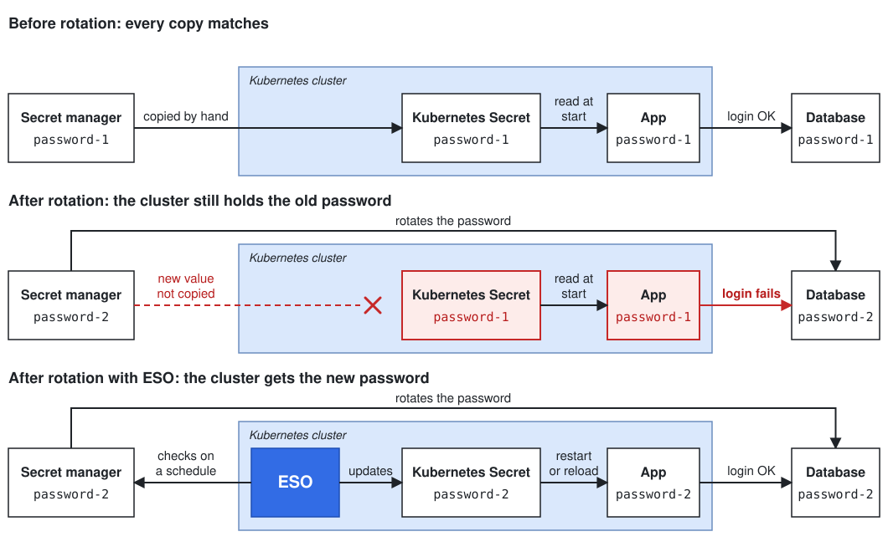

# Getting acquainted with ESO

## Why External Secrets?

Most applications handle passwords to communicate between components, these are kept in a secret manager, which controls who can read them and rotates them regularly. Your Kubernetes applications are no exception, the only difference is that they don't read from your secret manager, they have their own place to store sensitive values called Secrets.

So getting the password to your app takes two steps:

1. Someone copies the password from the secret manager into a Kubernetes Secret.
2. Kubernetes gives the value in that Secret to your app when the app starts.

That works until the password rotates. The secret manager
then holds the new value, the cluster still holds the old one, and your app
can't log in to its database until someone notices and copies it again. Every
additional secret, namespace and cluster is another copy to keep up to date.

External Secrets Operator (ESO) closes that gap. You declare which secret you
want and where it lives, and ESO creates the Kubernetes Secret and keeps it up
to date. Your app still reads a normal Kubernetes Secret, so it doesn't need to
know ESO exists.



## How does External Secrets work?

External Secrets runs inside your cluster and adds new types of Kubernetes resource. You
describe what you want with two of them, and ESO does the copying:

- A **SecretStore** says where your secrets live and how ESO logs in to that
  secret manager.
- An **ExternalSecret** says which secret to fetch and which Kubernetes Secret
  to put it in.

External secrets then repeats the same loop for each ExternalSecret:

1. Finds the SecretStore that the ExternalSecret points to.
2. Connects to the secret manager and fetches the value.
3. Creates or updates the Kubernetes Secret.
4. Waits for the refresh interval, then starts again.

The secret manager stays the source of truth, so a rotated password reaches
your cluster on the next refresh. To go deeper, see
[Architecture, controller classes and reconciliation](../explanations/architecture-controllerclasses-and-reconciliation.md).

## What you will learn

In this tutorial, you install ESO on a local cluster and sync the password into
a Kubernetes Secret. You then will rotate the password and watch the new value
arrive. Finally, you break the sync on purpose, so you know what a failure looks
like and where to look.

You don't need a cloud account. ESO's fake provider stands in for the secret
manager.

## Before you begin

Install these tools:

- [Docker](https://docs.docker.com/get-docker/)
- [kind](https://kind.sigs.k8s.io/docs/user/quick-start/#installation)
- [kubectl](https://kubernetes.io/docs/tasks/tools/)
- [Helm](https://helm.sh/docs/intro/install/)

<!--
Template for each step. Keep the opening sentence and the three labels, in this
order. Replace each placeholder, using its prefix as the type of content:

  Command:  a shell block the reader runs
  Manifest: a YAML block the reader applies
  Output:   the expected output, trimmed to the lines that matter
  Explain:  one or two short paragraphs for the reader

Use the names from the table in "The full picture" in every command and manifest.
-->

## Step 1: Install ESO

Everything in this tutorial happens inside a Kubernetes cluster, so start by
creating one and installing ESO on it.

Create a local Kubernetes cluster:

```shell
kind create cluster --name eso-tutorial
```

Install ESO with Helm. The `--wait` flag makes Helm wait until ESO is running,
so the last command can take a minute or two:

```shell
helm repo add external-secrets https://charts.external-secrets.io
helm repo update
helm install external-secrets external-secrets/external-secrets \
  --namespace external-secrets \
  --create-namespace \
  --wait
```

Check that all three ESO deployments are running. Each one shows `1/1` under
`READY`:

```shell
kubectl get deployments -n external-secrets
```

```text
NAME                               READY   UP-TO-DATE   AVAILABLE   AGE
external-secrets                   1/1     1            1           55s
external-secrets-cert-controller   1/1     1            1           55s
external-secrets-webhook           1/1     1            1           55s
```

Then check that ESO's resource types are installed. The list includes the two
you use next, `secretstores` and `externalsecrets`:

```shell
kubectl get crds | grep external-secrets.io
```

```text
clusterexternalsecrets.external-secrets.io      2026-11-08T13:34:55Z
clusterpushsecrets.external-secrets.io          2026-11-08T13:34:55Z
clustersecretstores.external-secrets.io         2026-11-08T13:34:55Z
externalsecrets.external-secrets.io             2026-11-08T13:34:55Z
pushsecrets.external-secrets.io                 2026-11-08T13:34:55Z
secretstores.external-secrets.io                2026-11-08T13:34:55Z
...
```

Your list also has entries ending in `generators.external-secrets.io`. These
belong to generators, which create new values instead of fetching existing ones.
This tutorial doesn't use them.

ESO now runs in your cluster as an *operator*, a program that keeps resources in
the state you describe. You don't tell it what to do step by step. You declare
the result you want, and it keeps working to make that true. For ESO, that
result is a Kubernetes Secret that holds the right value.

You declare that result with new resource types. Kubernetes only knows its
built-in types, such as Pods and Secrets, until a *CustomResourceDefinition*
(CRD) adds another. The CRDs in the list above came with the Helm chart, so you
can now use `kubectl apply` and `kubectl get` with SecretStores and
ExternalSecrets, the same way you would with a Pod.

Each of the three deployments has one job:

- `external-secrets` is the controller. It turns ExternalSecrets into Kubernetes
  Secrets.
- `external-secrets-webhook` validates ESO resources and fills in their defaults
  when you apply them.
- `external-secrets-cert-controller` manages the webhook's TLS certificates.

## Step 2: Connect to the "secret manager"

ESO needs to know where your secrets live, so create a SecretStore that points
to them.

Create a namespace for your app:

```shell
kubectl create namespace my-app
```

Save this manifest as `secret-store.yaml`. The `data` list stands in for the
contents of your secret manager, and holds one password:

```yaml
apiVersion: external-secrets.io/v1
kind: SecretStore
metadata:
  name: company-secrets
  namespace: my-app
spec:
  provider:
    fake:
      data:
        - key: /prod/db/password
          value: first-password
```

Apply it. Each time you apply this manifest, `kubectl` prints
`Warning: store company-secrets isn't currently maintained`. ESO flags the fake
provider as not maintained, and the warning doesn't affect this tutorial:

```shell
kubectl apply -f secret-store.yaml
```

Check that the store is ready. Within a few seconds, it shows `Valid` under
`STATUS` and `True` under `READY`:

```shell
kubectl get secretstore -n my-app
```

```text
NAME              AGE   STATUS   CAPABILITIES   READY
company-secrets   3s    Valid    ReadWrite      True
```

A *provider* is the system that holds your secrets, such as AWS Secrets Manager
or HashiCorp Vault. ESO has a connector for each provider it supports. The fake
provider is one of those connectors, but it reads its values from the
SecretStore manifest instead of a remote service.

A SecretStore connects ESO to one provider, and ESO checks that connection when
you apply it. A SecretStore also only serves ExternalSecrets in its own
namespace, so `company-secrets` is available in `my-app` and nowhere else. That
boundary lets each team control access to its own secrets.

A SecretStore for a real provider also says how ESO authenticates to it. That
is the main thing that changes when you move off the fake provider.

!!! warning "For learning only"
    The fake provider keeps its values in plain text in the SecretStore manifest. Never put a real credential in it.

## Step 3: Ask for the password

ESO can now reach the secret manager, so declare which secret you want with an
ExternalSecret.

Save this manifest as `external-secret.yaml`:

```yaml
apiVersion: external-secrets.io/v1
kind: ExternalSecret
metadata:
  name: fetch-db-password
  namespace: my-app
spec:
  refreshInterval: 10s
  secretStoreRef:
    name: company-secrets
    kind: SecretStore
  target:
    name: db-credentials
  data:
    - secretKey: password
      remoteRef:
        key: /prod/db/password
```

Apply it:

```shell
kubectl apply -f external-secret.yaml
```

Check that the sync worked. Within a few seconds, the ExternalSecret shows
`SecretSynced` under `STATUS` and `True` under `READY`:

```shell
kubectl get externalsecret -n my-app
```

```text
NAME                STORETYPE     STORE             REFRESH INTERVAL   STATUS         READY   LAST SYNC
fetch-db-password   SecretStore   company-secrets   10s                SecretSynced   True    3s
```

An ExternalSecret is a request: fetch this value and put it there. Each field
answers one part of that request:

- `secretStoreRef` says where to fetch from. It names the `company-secrets`
  SecretStore you created in Step 2.
- `remoteRef.key` says which secret to fetch. It's the name of the secret in the
  provider, so it matches the `key` in your SecretStore.
- `secretKey` says what to call the value in the Kubernetes Secret. A Secret can
  hold several values, each under its own key, and this one is `password`.
- `target.name` says which Kubernetes Secret to write. ESO creates
  `db-credentials` for you, in the same namespace as the ExternalSecret.
- `refreshInterval` says how often ESO fetches the value again. This tutorial
  uses `10s` so you can see changes quickly. If you leave the field out, ESO
  refreshes every hour.

The value's name in the provider and its name in the cluster are independent, so
your app can use a simple name like `password` wherever the secret really lives.

## Step 4: Read the result

ESO has created a Kubernetes Secret, so check that it holds the password from
the store.

Kubernetes stores Secret values base64-encoded, so decode the password to read
it. The output is the same value as `/prod/db/password` in your SecretStore:

```shell
kubectl get secret db-credentials -n my-app -o jsonpath='{.data.password}' | base64 --decode; echo
```

```text
first-password
```

`db-credentials` is a normal Kubernetes Secret. Nothing about it is specific to
ESO, so your app reads it the way it would any other Secret, as an environment
variable or a mounted file. The app doesn't need ESO's libraries or access to
the secret manager.

Base64 is not encryption, so anyone who can read this Secret can decode the
password. Limit access to it with RBAC, as you would for any Kubernetes Secret.

The ExternalSecret also owns this Secret, and the Secret's
`metadata.ownerReferences` field names `fetch-db-password` as its owner. If you
delete the ExternalSecret, Kubernetes deletes the Secret too. If you delete only
the Secret, ESO creates it again.

## Step 5: Rotate the password

Without ESO, this is where someone has to copy the new password by hand. This
time, you change it in one place and let ESO do the copying.

Change the password in `secret-store.yaml` and apply the file again:

```shell
sed -i.bak 's/first-password/rotated-password/' secret-store.yaml
kubectl apply -f secret-store.yaml
```

Wait about 10 seconds for the next refresh, then decode the Secret again. It now
holds the new password:

```shell
kubectl get secret db-credentials -n my-app -o jsonpath='{.data.password}' | base64 --decode; echo
```

```text
rotated-password
```

You didn't touch the ExternalSecret or the Kubernetes Secret. ESO's loop is
called *reconciliation*: on each refresh, it reads the value from the provider,
compares it with the Kubernetes Secret, and closes any difference.

The direction of that copy matters. The provider is the source of truth and the
Kubernetes Secret is only a copy, so when they differ, the provider wins. A
manual edit to `db-credentials` wouldn't last, because ESO would replace it with
the provider's value.

You rotated the password by editing a manifest because that's where the fake
provider keeps its values. With a real provider, the rotation happens in the
secret manager and you change nothing in the cluster.

ESO updates the Secret, not your app. An app that reads the password from a
mounted file sees the new value after Kubernetes refreshes the volume. An app
that reads it from an environment variable keeps the old value until it
restarts.

## Step 6: Break it, then fix it

Syncs fail in real life, so it helps to see a failure while nothing depends on
it.

Introduce a typo. Replace the contents of `external-secret.yaml` with this
manifest, where `remoteRef.key` now points at `/prod/db/passwrd`, a key that
doesn't exist:

```yaml
apiVersion: external-secrets.io/v1
kind: ExternalSecret
metadata:
  name: fetch-db-password
  namespace: my-app
spec:
  refreshInterval: 10s
  secretStoreRef:
    name: company-secrets
    kind: SecretStore
  target:
    name: db-credentials
  data:
    - secretKey: password
      remoteRef:
        key: /prod/db/passwrd
```

Apply it:

```shell
kubectl apply -f external-secret.yaml
```

Wait a few seconds, then look at the summary. The ExternalSecret shows
`SecretSyncedError` under `STATUS` and `False` under `READY`, so you know the
sync is failing:

```shell
kubectl get externalsecret -n my-app
```

```text
NAME                STORETYPE     STORE             REFRESH INTERVAL   STATUS              READY   LAST SYNC
fetch-db-password   SecretStore   company-secrets   10s                SecretSyncedError   False   6s
```

Read the details to find out which part failed. In the output, trimmed here to
the lines that matter, the status and events say ESO couldn't fetch the value
from the provider:

```shell
kubectl describe externalsecret fetch-db-password -n my-app
```

```text
  Conditions:
    Message:                could not get secret data from provider
    Reason:                 SecretSyncedError
    Status:                 False
    Type:                   Ready
Events:
  Type     Reason        Age              From              Message
  ----     ------        ----             ----              -------
  Warning  UpdateFailed  2s (x3 over 5s)  external-secrets  could not get secret data from provider
```

That message stays general on purpose. Provider errors can contain secret
values, and a status message is visible to anyone who can read the
ExternalSecret. ESO sends the specific cause to its controller logs instead.

Look in the logs for the most recent error. It names the key that's missing:

```shell
kubectl logs deployment/external-secrets -n external-secrets | grep -o '"error":"[^"]*"' | tail -n 1
```

```text
"error":"error processing spec.data[0] (key: /prod/db/passwrd), err: Secret does not exist"
```

Now fix the typo. Replace the contents of `external-secret.yaml` with the
original manifest:

```yaml
apiVersion: external-secrets.io/v1
kind: ExternalSecret
metadata:
  name: fetch-db-password
  namespace: my-app
spec:
  refreshInterval: 10s
  secretStoreRef:
    name: company-secrets
    kind: SecretStore
  target:
    name: db-credentials
  data:
    - secretKey: password
      remoteRef:
        key: /prod/db/password
```

Apply it:

```shell
kubectl apply -f external-secret.yaml
```

Check the ExternalSecret again. After a few seconds, it reports a healthy sync:

```shell
kubectl get externalsecret -n my-app
```

```text
NAME                STORETYPE     STORE             REFRESH INTERVAL   STATUS         READY   LAST SYNC
fetch-db-password   SecretStore   company-secrets   10s                SecretSynced   True    5s
```

Follow the same order whenever a sync fails. `kubectl get` tells you that it's
failing, `kubectl describe` tells you which part failed, and the controller logs
tell you why.

By default, ESO doesn't change `db-credentials` when a sync fails, so your app
can still read the last value that synced.

## The full picture

ESO reads from the provider through the SecretStore, as the ExternalSecret
directs, and writes the result to a Kubernetes Secret. Each piece has one job:

| Piece             | In this tutorial                                | Its job                                        |
| ----------------- | ----------------------------------------------- | ---------------------------------------------- |
| Provider          | Fake provider, key `/prod/db/password`        | Holds the value. It's the source of truth.     |
| SecretStore       | `company-secrets` in the `my-app` namespace | Tells ESO how to reach the provider.           |
| ExternalSecret    | `fetch-db-password`                           | Says which value to fetch and where to put it. |
| Kubernetes Secret | `db-credentials`                              | Holds the copy your app reads.                 |

## Clean up

Delete the kind cluster. This removes everything you created in this tutorial:

```shell
kind delete cluster --name eso-tutorial
```

## Where to go next

This tutorial used a SecretStore, which only serves its own namespace. A
ClusterSecretStore works the same way but can serve any namespace, so it needs
more care on shared clusters.

Keep learning with these tutorials:

- [Generate secrets directly in Kubernetes](generate-secrets-in-kubernetes.md)
- [Publish your Kubernetes Secret to a provider](publish-your-secret-to-a-provider.md)
- [Understand what ESO policies are](understand-eso-policies.md)
- [Deploy ESO securely](deploy-eso-securely.md)

Or read more about the concepts in this tutorial:

- [SecretStore vs ClusterSecretStore](../explanations/secretstore-vs-clustersecretstore.md)
- [Refresh and ownership/deletion lifecycle](../explanations/refresh-and-ownership-deletion-lifecycle.md)
- [Architecture, ControllerClasses and controller reconciliation](../explanations/architecture-controllerclasses-and-reconciliation.md)
- [Security model and threat model](../explanations/security-model-and-threat-model.md)
